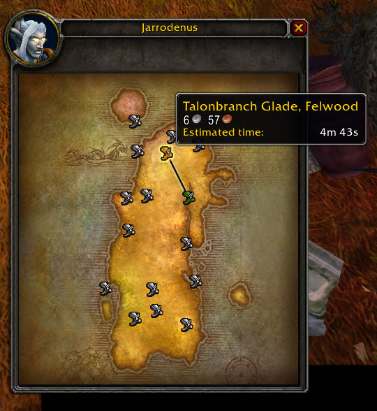
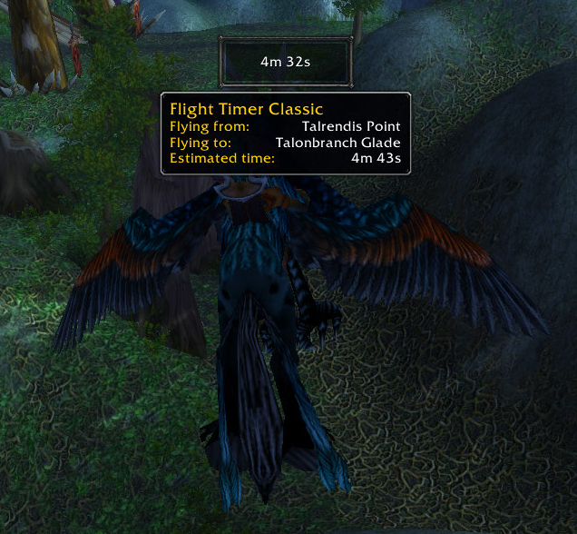
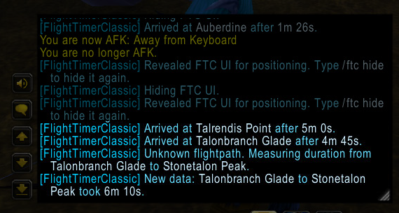

# Flight Timer Classic

Record and display flight durations for WoW Forever and Classic Era.

The time shown for a route is an estimate from the path length until a character has flown that route.

Available commands: 

* `/ftc mute` – Show whether the login message and the flight report are muted.
* `/ftc mute login` – Mute or show the login message.
* `/ftc mute report` – Mute or show the flight report.
* `/ftc mute all` – Mute the login message and the flight report.
* `/ftc mute none` – Show the login message and the flight report.
* `/ftc show` – Show the timer for positioning.
* `/ftc hide` – Hide the timer.
* `/ftc debug` – Turn debug output on or off.
* `/ftc help` – Show help.

Shift-click the timer while typing a chat message to paste your arrival.

Huge credit to [PhanxFlightTimer](https://github.com/phanx-wow/PhanxFlightTimer), 
[InFlight](https://www.curseforge.com/wow/addons/inflight-taxi-timer) and 
[Consequence-Flightmaster](https://www.curseforge.com/wow/addons/consequence-flightmaster)
from which I more or less frankensteined this AddOn together.

----

* License: [CC BY 2.0](https://creativecommons.org/licenses/by/2.0/)
* [Flight Timer Classic at CurseForge](https://www.curseforge.com/wow/addons/flight-timer-classic)
* [Flight Timer Classic at GitHub](https://github.com/timohausmann/FlightTimerClassic) 

    